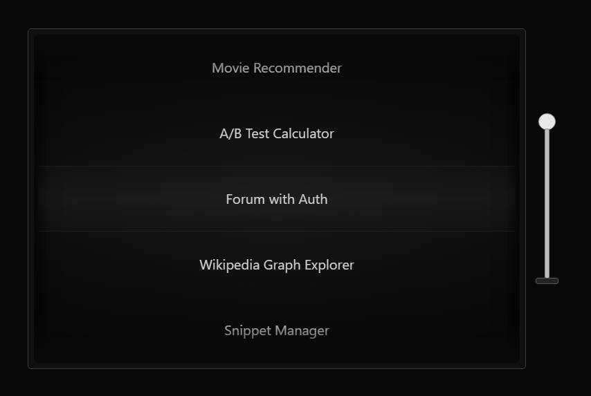

# Project Spin

A slot machine with one reel and five visible rows. Pull the handle, the reel stops on five project ideas, and the middle idea is highlighted as the winner.

No frameworks, no build step, no dependencies. Open `index.html` in a browser.

## Demo



*Pulling the handle: the reel blurs through the filler ideas, lands on five new titles, and highlights the middle one as the winner.*

## Using it

- Click the handle on the right of the box, or press Space anywhere, to spin.
- Five project titles are visible at once, centered in a shaded drum-like window.
- When the reel stops, the middle row gets a subtle white highlight and slightly larger text.
- Sound is synthesized live (lever, ticks, clunk, two-note chime). There is no mute button.

## Files

```
index.html      the box, the reel, the handle
css/style.css   minimal layout and monochrome styling
js/ideas.js     the idea database (82 projects)
js/audio.js     Web Audio sound effects
js/app.js       reel animation, distinct picks, winner highlight
assets/demo.gif the demo shown at the top of this README
```

## How the spin works

The reel window is exactly five rows tall. On a spin the strip is rebuilt as:

```
[ five previous ideas ][ forty filler ideas ][ five new ideas ]
```

The strip launches with a quick acceleration, blurs through a fast middle at a constant speed, then eases smoothly to a stop with a small mechanical jolt, so the five new ideas land exactly in the window. The third visible row gets the highlight.

The five new ideas are drawn distinct, and the previous spin's ideas are excluded when possible.

## Adding your own ideas

Append titles to the `IDEAS` array in `js/ideas.js`:

```js
"My Project",
```

Each entry is just the text shown in the reel.

## Notes

- `prefers-reduced-motion` shortens the spin to 300ms; a normal spin takes about four and a half seconds.
- The machine scales with the viewport: large in full screen, compact in narrow windows.
- Press Space anywhere on the page to spin; Enter works when the handle has focus.
- The handle is a real button, so it is reachable by keyboard and screen readers.
